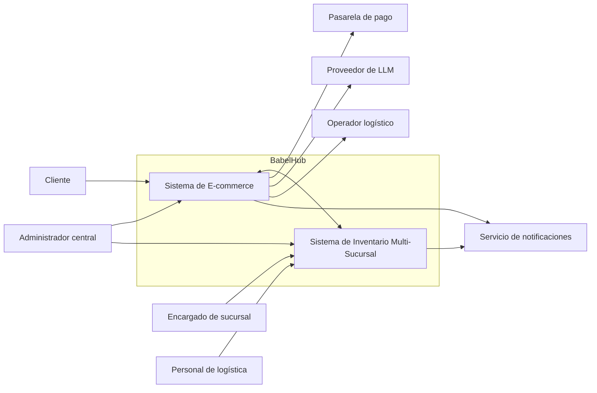

# 01 — Actores del Sistema

Un **actor** es toda persona o sistema externo que interactúa con BabelHub. Se distinguen los actores directos (personas) de los sistemas externos con los que BabelHub se integra.

## 1. Actores directos

| Actor | Descripción | Objetivos principales | Sistema con el que interactúa |
| --- | --- | --- | --- |
| **Cliente** | Persona que compra libros en línea. Puede navegar como visitante o autenticarse como cliente registrado. | Buscar títulos, conocer la disponibilidad real, comprar con despacho a domicilio o recojo en sucursal, y seguir su pedido. | E-commerce |
| **Encargado de sucursal** | Personal de una tienda física. Su acceso está limitado a **su propia sucursal**. | Consultar el stock local, registrar ajustes, preparar pedidos de recojo, solicitar, aprobar y recibir traslados. | Inventario (y pedidos de su sucursal en E-commerce) |
| **Administrador central** | Personal de la administración de la librería con visibilidad nacional. | Gestionar el catálogo, usuarios y roles, consultar indicadores consolidados por sucursal y región, y revisar la auditoría. | E-commerce e Inventario |
| **Personal de logística / traslados** | Responsable de mover productos entre sucursales y de coordinar los envíos a domicilio. | Dar seguimiento a los traslados "en tránsito" y generar guías de envío. | Inventario y E-commerce |

## 2. Sistemas externos

| Sistema externo | Descripción | Interacción con BabelHub |
| --- | --- | --- |
| **Pasarela de pago (Niubiz o Culqi)** | Agregador de pagos que procesa Yape y tarjetas, con comisión por transacción y sin costo fijo mensual. | El E-commerce envía el cobro y recibe la confirmación. Se debe garantizar que el pago se procese una sola vez por transacción. |
| **Proveedor de LLM (ej. API de Claude)** | Modelo de lenguaje externo que da soporte al Asistente de Compra. | El Servicio de Asistente le envía consultas con contexto del Catálogo e Inventario y recibe respuestas. |
| **Operador logístico externo** | Empresa de courier para despachos a domicilio. | Generación de guías de envío y consulta de seguimiento (tracking). |
| **Servicio de notificaciones (correo / SMS)** | Proveedor de mensajería (por definir). | Envío de avisos al cliente y a las sucursales ante cambios de estado de pedidos y traslados. |
| **Let's Encrypt** | Autoridad certificadora. Actor de infraestructura, no funcional. | Emisión y renovación de certificados TLS en el proxy inverso. |

## 3. Componentes internos que participan (no son actores)

- **Servicio de Identidad y Seguridad:** autentica a los actores directos y emite los JWT con rol y alcance de sucursal.
- **Servicio de Inventario Multi-Fuente:** es consumido por el E-commerce y por el Asistente de Compra mediante API REST.

## 4. Matriz Actor × Módulo

| Módulo | Cliente | Encargado de sucursal | Administrador central | Logística |
| --- | :---: | :---: | :---: | :---: |
| Catálogo (consulta y búsqueda) | ✅ | ✅ | ✅ | ✅ |
| Catálogo (alta, edición y baja) | — | — | ✅ | — |
| Carrito y checkout | ✅ | — | — | — |
| Pagos | ✅ | — | 👁 | — |
| Pedidos | ✅ (propios) | ✅ (de su sucursal) | ✅ | ✅ |
| Inventario por sucursal | — | ✅ (propia) | ✅ (todas) | 👁 |
| Ajustes de inventario | — | ✅ (propia) | ✅ | — |
| Traslados entre sucursales | — | ✅ (solicita, aprueba y recibe) | ✅ | ✅ (seguimiento) |
| Asistente de compra | ✅ | — | — | — |
| Indicadores y reportes | — | ✅ (propia) | ✅ (consolidado) | — |
| Usuarios, roles y auditoría | — | — | ✅ | — |

✅ acceso completo · 👁 solo lectura · — sin acceso

## 5. Relación entre actores y sistemas

