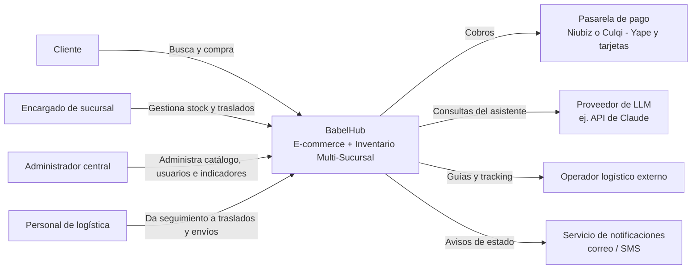
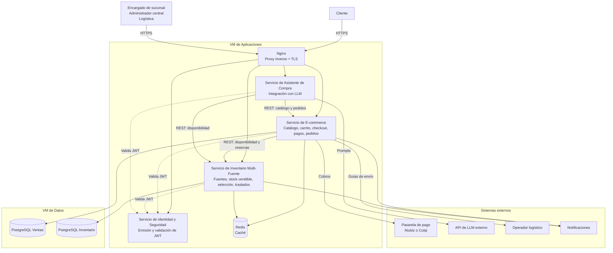
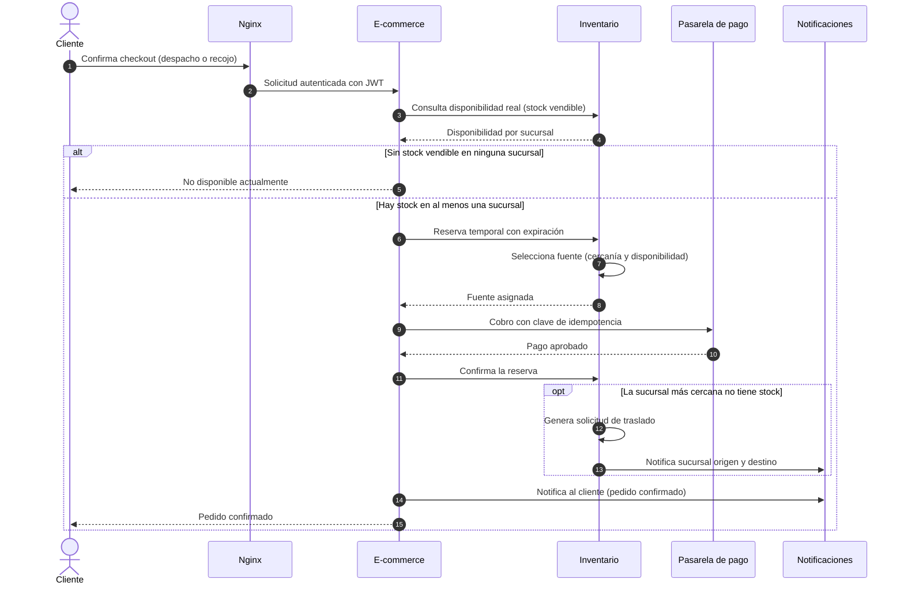
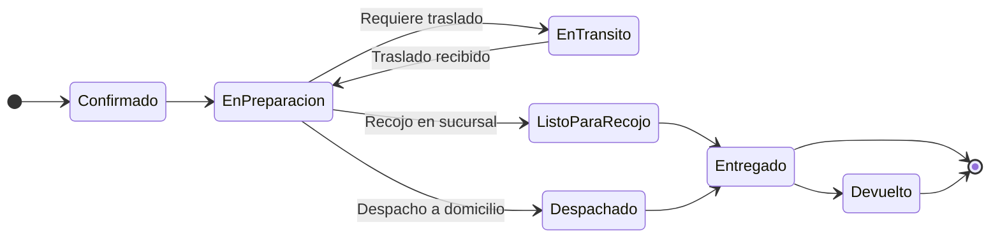
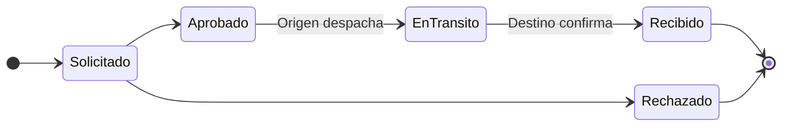
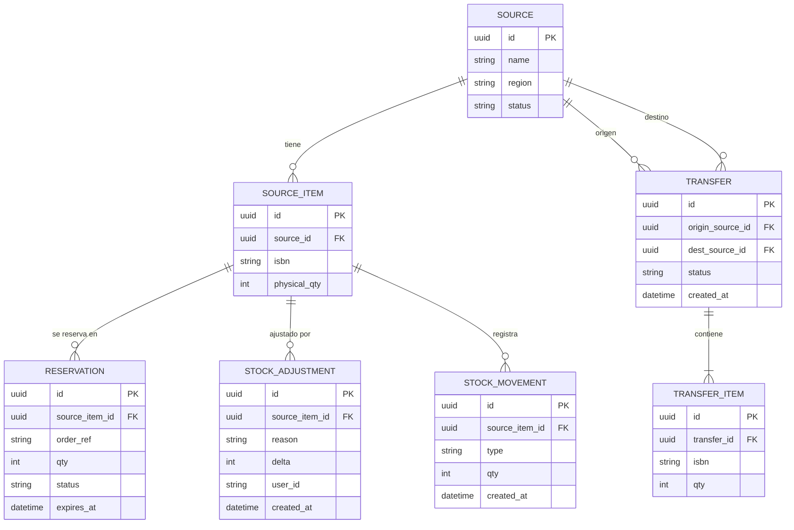
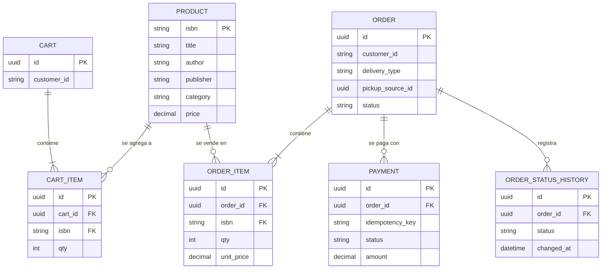
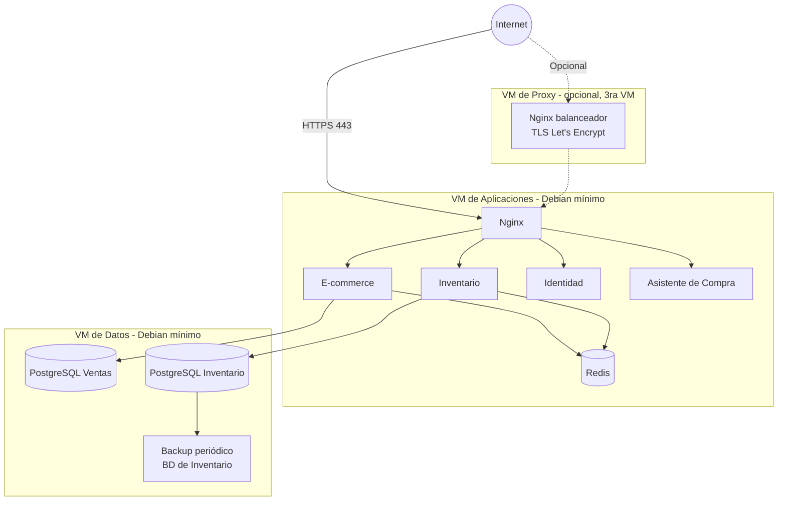

# Arquitectura Inicial del Sistema — BabelHub

Documento de arquitectura inicial basado en el **modelo C4** (niveles 1 y 2) y en el marco **IEEE 1016**. Los diagramas se elaboran con **Mermaid**.

## 1. Resumen

BabelHub se compone de dos sistemas independientes pero interoperables:

- **Sistema de E-commerce** (cliente final): catálogo, carrito, checkout, pagos, pedidos y asistente de compra.
- **Sistema de Inventario Multi-Sucursal** (personal interno): fuentes por sucursal, stock vendible, selección de fuente y traslados, según el patrón **Multi-Source Inventory**.

**Estilo arquitectónico:** servicios desacoplados de granularidad gruesa (no microservicios finos), comunicados por REST síncrono, con una base de datos por servicio, caché Redis y un proxy inverso como único punto de entrada. Se descarta una descomposición mayor porque, para 5–10 sucursales, solo añadiría complejidad de despliegue sobre infraestructura propia y limitada.

## 2. Contexto del sistema (C4 — Nivel 1)

## 3. Contenedores (C4 — Nivel 2)

### 3.1 Descripción de contenedores

| Contenedor | Tecnología | Responsabilidad |
| --- | --- | --- |
| **Servicio de E-commerce** | .NET 10, ASP.NET Core | Catálogo, carrito persistente, checkout, pagos, pedidos y notificaciones al cliente. Es el único contenedor con el que interactúa el cliente final. |
| **Servicio de Inventario Multi-Fuente** | .NET 10, ASP.NET Core | Registro de fuentes (sucursales), cálculo de stock vendible, reservas, selección de fuente, traslados y ajustes con auditoría. Expone la API consumida por E-commerce y el Asistente. |
| **Servicio de Identidad y Seguridad** | .NET 10, ASP.NET Core | Autenticación, roles y emisión/validación de JWT con el alcance de sucursal. |
| **Servicio de Asistente de Compra** | .NET 10, ASP.NET Core | Integración con un LLM externo; consulta las API de Catálogo e Inventario para fundamentar recomendaciones y respuestas. |
| **Caché** | Redis | Disponibilidad consolidada (expiración corta) y catálogo (expiración mayor). |
| **Proxy inverso** | Nginx | Punto de entrada único, enrutamiento y terminación TLS (Let's Encrypt). |
| **BD Ventas** | PostgreSQL | Datos del servicio de E-commerce. |
| **BD Inventario** | PostgreSQL | Datos del servicio de Inventario, separada por su alto volumen de escritura (reservas y traslados). |

> **Supuestos a confirmar:** (1) el Servicio de Identidad guarda sus datos en un esquema propio dentro de la instancia PostgreSQL de Ventas; (2) el Asistente de Compra y Redis se ubican en la VM de Aplicaciones, ya que la propuesta original no los asigna explícitamente a una VM.

### 3.2 Reglas de comunicación

- **E-commerce ↔ Inventario:** REST síncrono. Sin bus de eventos.
- **Asistente → E-commerce e Inventario:** solo por API; nunca accede a las bases de datos.
- **Todos los servicios:** validan el JWT emitido por el Servicio de Identidad.
- **Secretos** (claves de pago y de LLM): variables de entorno, nunca en el repositorio.

## 4. Flujo principal: compra con selección de fuente

## 5. Estados del pedido y del traslado

## 6. Modelo de datos conceptual

### 6.1 BD de Inventario

El **stock vendible** se calcula como `physical_qty − SUM(qty de reservas activas)` por fuente y título.

### 6.2 BD de Ventas

> Es un modelo **conceptual**; el detalle (tipos, índices y restricciones) se definirá en las especificaciones de cada módulo.

## 7. Arquitectura de despliegue

| VM | Contenedores | Entorno local | Oracle Cloud Free Tier (ARM) |
| --- | --- | --- | --- |
| **Aplicaciones** | Nginx, E-commerce, Inventario, Identidad, Asistente, Redis | 2 vCPU / 4 GB | 1 OCPU / 6 GB |
| **Datos** | PostgreSQL Ventas, PostgreSQL Inventario | 2 vCPU / 4 GB | 1 OCPU / 6 GB |
| **Proxy** (opcional) | Nginx balanceador, TLS | 1 vCPU / 1–2 GB | — |

**Criterios de despliegue**

- Debian estable en instalación mínima, **sin entorno gráfico**, en todas las VMs.
- Docker con imágenes **multi-arch** (x86_64 y ARM64) y Docker Compose con un manifiesto por entorno.
- La instancia pública corre en Oracle Cloud; el entorno local se reserva para desarrollo y pruebas.

## 8. Seguridad (visión inicial)

| Medida | Descripción |
| --- | --- |
| Acceso por SSH | Solo con llave pública, sin contraseña. |
| Firewall del SO | `nftables` o `ufw`, exponiendo únicamente HTTP/HTTPS y SSH. |
| TLS | Gestionado con Let's Encrypt en el proxy inverso. |
| Autenticación y autorización | JWT / OAuth 2.0 con rol y alcance de sucursal codificados en el token. |
| Respaldos | Backup periódico de la BD de Inventario, de mayor impacto operativo si se pierde. |
| Secretos | Claves de pago y de LLM como variables de entorno, fuera del repositorio. |
| Datos de pago | Procesados por la pasarela; BabelHub no almacena datos de tarjeta. |
| Protección de datos personales | Cumplimiento de la Ley N.° 29733. |

## 9. Decisiones de arquitectura y atributos de calidad

| Atributo | Cómo lo atiende la arquitectura |
| --- | --- |
| Consistencia de inventario | Servicio y BD dedicados, reservas transaccionales y stock vendible = físico − reservas. |
| Rendimiento | Caché Redis para disponibilidad y catálogo. |
| Disponibilidad | Reinicio automático de contenedores, instancia pública en Oracle Cloud y backups. |
| Escalabilidad | Cada sucursal es una fuente nueva; recursos asignables por contenedor. |
| Modificabilidad | Límites claros entre servicios, contratos REST estables y pagos tras una interfaz. |
| Seguridad | JWT con alcance de sucursal, TLS, firewall y secretos fuera del código. |
| Portabilidad | Imágenes multi-arch y Docker Compose. |

El detalle de cada decisión (AD-01 a AD-10) está en [`06-drivers-arquitectonicos.md`](../analisis-de-sistema/06-drivers-arquitectonicos.md).

## 10. Estrategia de pruebas

| Nivel | Herramienta | Qué valida |
| --- | --- | --- |
| Unitarias | xUnit | Lógica aislada (ej. cálculo de stock vendible). |
| Integración | xUnit + Testcontainers | BD propia de cada servicio y comunicación REST E-commerce ↔ Inventario. |
| End-to-End | Playwright | Búsqueda → compra con recojo → cambio de estado del pedido. |
| Carga | k6 | Picos de tráfico, especialmente sobre el Servicio de Inventario. |

## 11. Pendientes para la siguiente etapa

- Especificaciones ejecutables por funcionalidad bajo **Spec-Driven Development** (selección de fuente, cálculo de stock vendible, traslados).
- Detalle de la interfaz REST E-commerce ↔ Inventario (contratos OpenAPI).
- Manifiestos de Docker Compose por entorno (local y Oracle Cloud).
- Especificación funcional por pantalla (cliente, sucursal y administración central).
- Definición del proveedor de notificaciones y del operador logístico.
