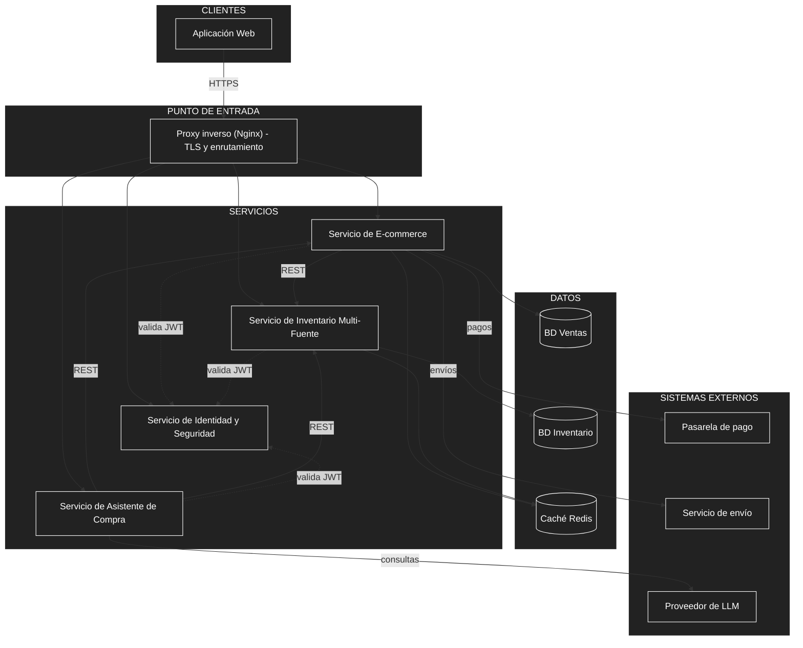

# Estilo arquitectónico

## Estilo seleccionado

**Arquitectura basada en servicios (Service-Based Architecture)** de granularidad gruesa, con **arquitectura en capas** dentro de cada servicio.

El sistema se divide en pocos servicios independientes, cada uno con una responsabilidad clara y con su propia base de datos cuando lo requiere. Se comunican mediante **API REST síncrona** y reciben las solicitudes externas a través de un **proxy inverso** que actúa como único punto de entrada.

No se adopta una arquitectura de microservicios finos: para una red de 5 a 10 sucursales, dividir el sistema en más servicios solo agregaría coordinación y complejidad de despliegue sin ventajas reales de escalamiento.

## Diagrama de arquitectura

## Estructura interna de cada servicio

Cada servicio sigue una organización en capas, de modo que los cambios en una capa no afecten innecesariamente a las demás.

## Componentes principales

| Componente | Responsabilidad |
| :--- | :--- |
| **Aplicación Web** | Interfaz de clientes, encargados de sucursal y administración central. Consume los servicios mediante API REST. |
| **Proxy inverso (Nginx)** | Único punto de entrada: enruta las solicitudes y gestiona el cifrado TLS. |
| **Servicio de E-commerce** | Catálogo, carrito, checkout, pagos y pedidos. Es el único servicio con el que interactúa el cliente final. |
| **Servicio de Inventario Multi-Fuente** | Registra cada sucursal como una fuente de stock, calcula el stock vendible (físico − reservas), selecciona la sucursal de despacho y gestiona traslados y ajustes. |
| **Servicio de Identidad y Seguridad** | Autentica a los usuarios y emite tokens JWT con su rol y la sucursal a la que pueden acceder. |
| **Servicio de Asistente de Compra** | Recomienda libros y responde consultas usando los datos reales de E-commerce e Inventario y un proveedor de LLM. |
| **BD Ventas / BD Inventario** | Bases de datos PostgreSQL separadas: la de Inventario se aísla por su alto volumen de escritura (reservas y traslados). |
| **Caché Redis** | Guarda la disponibilidad (corta duración) y el catálogo (mayor duración) para reducir la carga en picos de tráfico. |
| **Sistemas externos** | Pasarela de pago, servicio de envío y proveedor de LLM, accedidos mediante API. |

## Relaciones entre componentes

| Origen | Destino | Tipo | Propósito |
| :--- | :--- | :--- | :--- |
| Aplicación Web | Proxy inverso | HTTPS | Enviar todas las solicitudes del usuario. |
| Proxy inverso | Servicios | HTTP | Enrutar cada solicitud al servicio correspondiente. |
| E-commerce | Inventario | REST síncrono | Consultar la disponibilidad real y solicitar reservas. |
| Asistente de Compra | E-commerce e Inventario | REST síncrono | Obtener datos para fundamentar sus respuestas, sin acceder directamente a las bases de datos. |
| Todos los servicios | Identidad | Validación de JWT | Verificar el rol y la sucursal permitidos. |
| E-commerce / Inventario | Su base de datos | SQL | Persistir su propia información. |
| E-commerce / Inventario | Redis | Caché | Acelerar la consulta de disponibilidad y catálogo. |
| E-commerce | Pasarela de pago y servicio de envío | API externa | Procesar pagos y gestionar entregas. |
| Asistente de Compra | Proveedor de LLM | API externa | Generar las respuestas del asistente. |

## Justificación

| Driver | Cómo lo atiende el estilo |
| :--- | :--- |
| **DA01** – Evitar la sobreventa | El inventario es un servicio propio con base de datos dedicada, lo que concentra el control de reservas y del stock vendible en un solo lugar. |
| **DA02** – Tiempos de respuesta en picos | Redis reduce las consultas a la base de datos, y el Servicio de Inventario puede recibir más recursos sin escalar el resto. |
| **DA03** – Incorporar nuevas sucursales | Cada sucursal es una nueva fuente de stock dentro del mismo servicio; no requiere cambios estructurales. |
| **DA04** – Acceso por sucursal y protección de datos | La autenticación está centralizada en un servicio que emite tokens con la sucursal permitida, y todos los servicios los validan. |
| **DA05** – Pasarela de pago externa | El E-commerce concentra la integración con la pasarela, por lo que cambiar de proveedor afecta a un solo servicio. |
| **DA06** – API REST | Toda la comunicación entre componentes usa REST, lo que es simple y uniforme. |
| **DA07** – Infraestructura propia limitada | Pocos servicios y contenedores sobre máquinas virtuales propias, sin orquestadores complejos. |

## Alternativas descartadas

| Alternativa | Motivo del descarte |
| :--- | :--- |
| **Monolito único** | Mezclaría el inventario con el e-commerce, dificultando su escalamiento y prueba por separado, siendo el inventario la parte más crítica y de mayor escritura. |
| **Microservicios finos** (catálogo, carrito y pagos por separado) | Agregan coordinación, comunicación y despliegue innecesarios para 5 a 10 sucursales. |
| **Arquitectura orientada a eventos (bus de mensajes)** | Su complejidad operativa no se justifica con el volumen previsto; REST síncrono es suficiente. |

## Ventajas y limitaciones

| Ventajas | Limitaciones |
| :--- | :--- |
| Separa el inventario, la parte más crítica, del resto del sistema. | La comunicación síncrona hace que E-commerce dependa de la disponibilidad de Inventario. |
| Pocos servicios: despliegue y mantenimiento sencillos. | Al compartir servicios de identidad y caché, estos son puntos que requieren cuidado en disponibilidad. |
| Permite escalar y probar cada servicio de forma independiente. | Mantener dos bases de datos exige gestionar la consistencia entre ventas e inventario mediante las llamadas REST. |
| Se adapta a infraestructura propia con recursos limitados. | Si la red crece mucho más allá de 20 sucursales, podría requerirse una revisión del estilo. |
